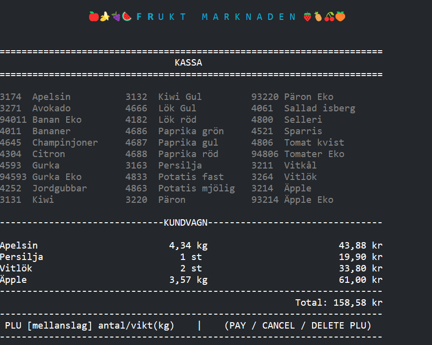
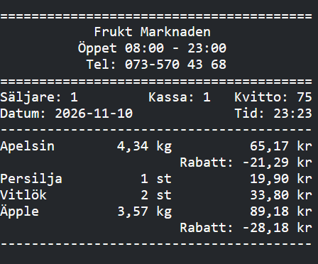

# 🍎 Frukt Marknaden – Kassasystem Console App

<p align="center">
  
</p>

Ett kassasystem för en frukt- och grönsaksbutik, byggt som en .NET‑konsolapplikation i C#.  
Kassören slår in varor med PLU‑kod, kundvagnen uppdateras direkt och köpet avslutas med ett kvitto där kampanjrabatter dras av automatiskt.  
All data lagras i textfiler (produkter, kampanjer och kvitton).

## 📸 Så ser det ut

| Kassavy med kundvagn | Kvitto med rabatter |
|---|---|
|  |  |

## ✨ Funktionalitet

🛒 **Kassa**  
- Slå in varor med `PLU [mellanslag] antal/vikt`  
- Pris per styck eller per kilo  
- Kundvagn och totalsumma uppdateras efter varje inslag  
- Kommandon: `PAY`, `CANCEL` och `DEL <PLU>`  
- Kontant eller kort vid betalning  

🏷️ **Kampanjer & Rabatter**  
- Procentrabatt, kampanjpris och mängdrabatt (köp X för Y kr)  
- Start‑ och slutdatum för kampanjer  
- Rabatten visas per rad på kvittot  

🧾 **Kvitto**  
- Säljare, kassa, kvittonummer, datum och tid  
- Löpande kvittonummer som sparas mellan körningar  
- Moms och betalningsuppgifter på kvittot  
- Dagens kvitton sparas i en egen fil (`RECEIPT_ÅÅÅÅMMDD.txt`)  

🔐 **Admin**  
- Inloggning till adminmenyn  
- Visa, ändra, lägga till och ta bort produkter  
- Egen meny för kampanjer  

## 🧱 Arkitektur

## 📦 Data
Data‑lagret innehåller allt som rör filerna och hur de läses och skrivs.

- **ProductFileLoader** – läser och sparar produkter i `products.txt` (skapar standardprodukter om filen saknas)  
- **CampaignFileLoader** – läser och sparar kampanjer i `campaigns.txt`  
- **IProductRepository / ProductFileRepository** – hämtar och sparar produkter  
- **IReceiptWriter / ReceiptFileWriter** – skriver kvitton till fil och visar dem i konsolen  
- **LoginService** – vem som är inloggad (säljare)  
- **RegisterService** – vilket kassanummer som används  

Fil‑läsning och skrivning ligger bakom interfaces, så lagringen kan bytas mot en databas utan att resten av koden ändras.

## 🧠 Core (affärslogik)
Core innehåller reglerna för kassan.

- **CartService** – lägger till och tar bort varor i kundvagnen  
- **DiscountService** – räknar ut rabatter utifrån aktiva kampanjer  
- **PaymentService** – val av betalsätt, kontant inbetalning och kvitto  
- **InputParser** – tolkar `PLU antal/vikt`  
- **CommandParser** – tolkar `PAY`, `CANCEL` och `DEL <PLU>`  
- **ProductService / CampaignService** – logik för produkter och kampanjer  
- **ReceiptNumberService** – håller koll på löpande kvittonummer  
- **InputService** – validerad inmatning (text, tal, datum, enhet) med ESC för att avbryta  

## 🎛️ Controllers (menyflöden)
Controllers styr navigeringen och kopplar ihop UI med logiken.

- **MainMenuController** – huvudmenyn  
- **LoginController** – inloggning för säljare  
- **CheckoutController** – kassaflödet  
- **AdminLoginController / AdminMenuController** – adminmenyn  
- **ProductAdminController** – hantering av produkter  
- **CampaignMenuController / CampaignAdminController** – hantering av kampanjer  

## 🖥️ UI‑lager
UI‑klasserna visar innehållet, controllers styr flödet och Core utför logiken.

- **BannerUI** – logga och rubriker  
- **MenuUI** – menyer  
- **ProductListUI** – produktlistan i kassan  
- **ProductInputUI** – inmatning av produkter  
- **CartUI** – kundvagnen  
- **ReceiptUI** – kvittot  
- **AdminUI** – adminvyer  

## 🗂️ Modeller
- **Product** – PLU, namn, pris, prisenhet, moms och kampanjdata  
- **Cart / CartItem** – kundvagnen och dess rader  
- **PriceUnit** – `Each` (per styck) eller `PerKilo` (per kilo)  

## 🛠️ Installation

1. Klona projektet  
2. Öppna `CashRegisterSystem.sln` i Visual Studio och tryck **F5**  
   eller kör i terminalen:  
   ```bash
   cd CashRegisterSystem
   dotnet run
   ```

Ingen databas behövs – produkter och kampanjer läses från textfilerna i projektet.

## 🧪 Tekniker

- C#  
- .NET 9 Console  
- Objektorienterad programmering (klasser, interfaces, enums)  
- Filhantering (`System.IO`)  

## ✍️ Utvecklat av
**Ninnie – Kassasystem Console App**
